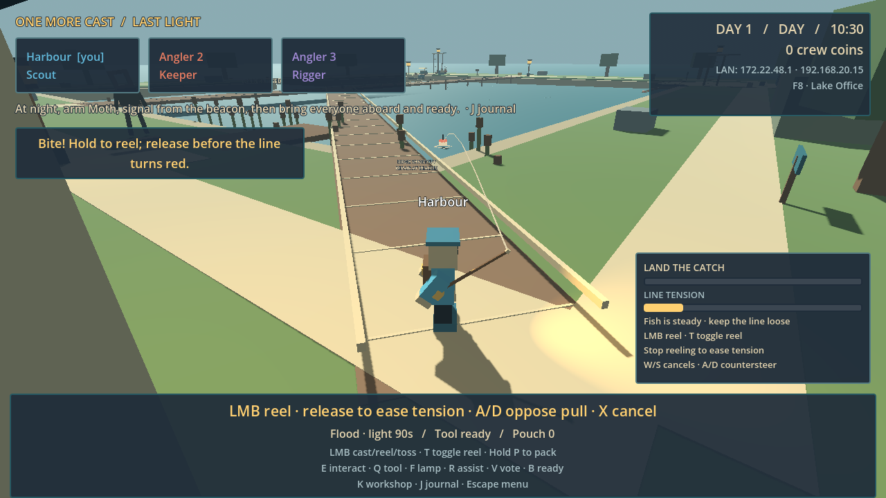
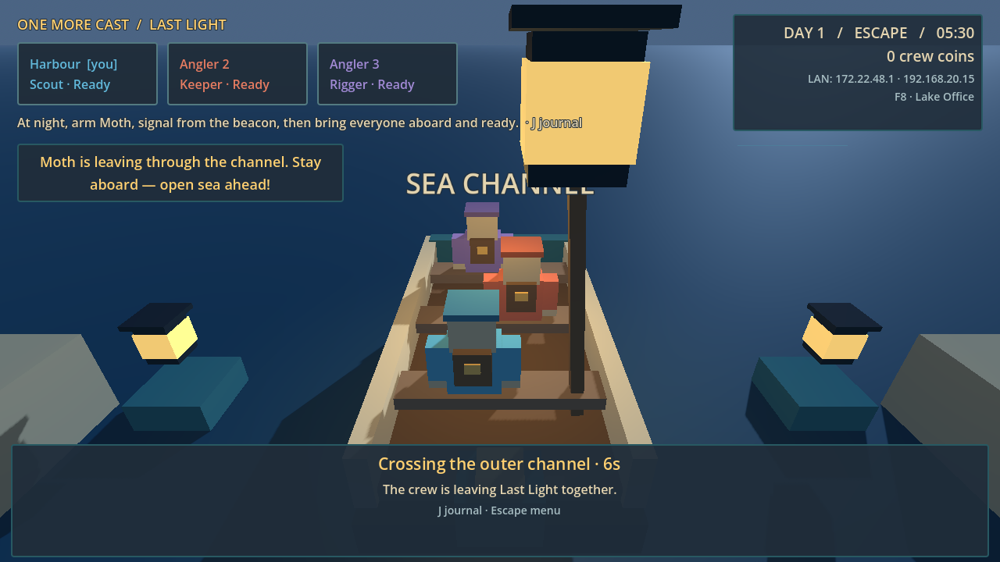

# Island Campaign — release evidence and family acceptance

## Compact standalone revision — 10 October 2026

Build `0.3.0-coast`, protocol 2, save schema 1. The current Windows package is exported and smoke-tested. The v0.2 section below is preserved historical evidence.

### What the game now asks you to do

Find the engine part and beacon coil, bank 120 shared coins, repair both, then signal and escape together at night. The two repairs work in either order. Three other improvements are optional and use found parts. Ordinary catches pack automatically; only oversized fish offer the optional carry/throw/whole-delivery bonus. First physical pull at the dock battery decides which field shelter stays lit for everyone; the other goes dark, with existing spare cells providing recovery. No majority ballot or extra health/hunger/cooking loop.

Rod, lantern and outfit are the three loadout choices. Rods each have one benefit and at most one tradeoff. Equipment, outfits, records and repairs survive retreat. Continue Island permits another night signal/escape while retaining permanent progress. This is a short finished adventure with optional further outings, not a promised 60–90 minute grind or an endlessly regenerating campaign.

### Verification of this source revision

- `logs/release-final-gut.log`: **285 tests, 2,634 assertions, 50 scripts pass**, no engine warnings/errors, after the network presentation and client-to-host reset fixes.
- `logs/compact-world-gut.log`: 16 focused world tests/141 assertions. Geometric, collision-checked routes at 5m/s: first fishing 3.28 seconds; longest useful route before repairs 24.63 seconds. Three actual starting lanes, all five casting water targets, and Moth water placement pass. Sixteen actual hunter-body route legs pass. These are not human navigation timings.
- `.tools/network-probe/20261010T013502575_592985ba/summary.json`: **191 checks**, real host/two ENet clients, protocol 2, after the final presentation fixes. Movement, fish transfer, disconnect/rejoin, actual escape RPCs, settlement and reload.
- `.tools/survival-network-probe/20261010T013421293_a769381b/summary.json`: **189 checks**, real host/two clients after the final presentation fixes. Cell toss/receive/delivery, carrying/drop/revive, pause/disconnect cleanup, reused IDs and stale-pose rejection. Authored old-world positions now use the compact layout transform; network error tolerances remain unchanged. Delivery is a shorter compact route than the old 20m fixture.
- `.tools/battery-network-probe/20261010T005723191_53bd4e20/summary.json`: **37 checks**, non-host choice changes cover for both other players, distance validation and second-pull rejection.
- `.tools/night-pressure-network-probe/20261010T010724609_51b90d62/summary.json`: **45 checks**, real warning/chase/down, remote carrying home and three-second revive. Same two-second movement: 9.94m free versus 8.35m loaded. In a deliberately close encounter with 0.8s lamp charge, keeping the load led to a down; dropping it allowed a 4.85s safe return. Initial positions/night/lamp are authored fixtures; subsequent movement and rescue use actual physics and ENet.
- All four network proofs exited naturally with code 0, no forced stops or engine warnings/errors. **462 network checks total**. They are loopback processes, not three physical PCs.
- `logs/compact-ordinary.stdout.log`: native public menu/Help/Host/W/LMB/A-D/pause input, a real ordinary catch in 15.1s reeling, automatically packed. No reward or position injection. No whole fish happened in this random native-input sample.
- `logs/compact-final-hud.stdout.log`: native 1280x720 and 960x540 menu/play/pause/equipment/journal layouts pass. `logs/compact-final-campaign.stdout.log`: seven native cast/trail/boat/ending frames pass using labelled fixtures. The actual normal-camera Reeds view is `logs/compact-main-reeds-night.png`; the earlier raw-camera foliage-obscured image is not acceptance evidence.

The earned outing probe passed **58 checks**, including the saved escape: `.tools/outing-pacing-probe/20261010T012158137_1efb1646/summary.json`. Two caught fish were banked in 47.7s, the first crafted/equipped loadout in 70.1s, and an oversized catch was thrown, recovered and banked whole by 107s. It earned all 150 coins and paid the 30-coin craft and 120-coin essential repairs. In the second outing, repairs were ready at 157.15s; 82.85s of waiting was explicitly skipped to nightfall. Two actual hunter approaches required retreat and recovery counterplay; the beacon was signalled at 282.17s, the player returned safely at 312.40s, then completed the real 20-second crossing and saved the ending. The earlier naive night route died to the real hunter and is retained as risk evidence.

Total measured work was 384.62 game seconds across those two outings: fishing 166.72s, travel/counterplay 167.07s, crossings/recap 48.18s, menus 1.25s and loose-cargo wait 1.4s. The run used actual Session intents, movement/collision, earned rewards and disk saving, with no injected coins, unlocks or player positions. Catch examples were seeded, input ideal and accelerated 4x, and menu dwell scripted. These are mechanical timing bounds, not human discovery/menu time or a family enjoyment claim.

### Smoothness first

`logs/performance-release-final.json` is the final isolated native 1280x720 OpenGL capture on an NVIDIA RTX 4070 Laptop GPU, VSync disabled, three rendered avatars and no real remote clients. Each day/night case sampled 15 seconds after four seconds of warmup; default settings were tested first. With shadows off, daylight p95/p99 were 4.51/5.06ms, maximum 11.63ms among 4,757 frames. Night p95/p99 were 4.50/5.91ms, maximum 8.03ms among 4,767 frames. Neither steady-state sample exceeded the 16.67ms budget for 60 FPS. Draw calls were 392–400 versus 1,847 with shadows; shadows-on night had one 21.87ms frame. Startup warmup reached 237.28ms and the first night transition 36.07ms, so zero startup/transition hitching is not claimed. These fixed-view samples do not prove every moving scene or another laptop's performance.

The first attempt timed out at its screenshot callback after two timing cases; the timing-only runner removed that callback and completed naturally with code 0 and no engine errors/warnings. Separate native visual probes remain the rendering evidence.

Independent review found that 20Hz remote player poses were visually stepped over one physics tick, then held for the other ticks. Remote crew and hunter presentation now transition across 50ms; local prediction corrections ease visually over 100ms with a 0.75m cap. Authority, collision bodies and transport remain unchanged. A deterministic 120Hz trace changed from 40 stopped frames among 60 steady-walk samples to zero. The actual camera-follow regression also passes. First pose, teleport, new outing and duplicate-snapshot tests prevent stale trails or extended deadlines. A real Session disconnect-to-Host regression reproduced retained remote presentation; taking host authority now clears it. The six focused tests/113 assertions pass (`logs/network-presentation-focused.log`) and are included in the final full suite.

### Review corrections

The fresh read-only outsider review found toggle-reel instructions incorrectly told players to release LMB. The HUD now distinguishes click-to-stop from hold/release, including surge and already-stopped states; regression reproduced and fixed (`logs/toggle-reel-hint-red.log`, `logs/toggle-reel-hint-green.log`). A misleading Soft-tip craft hint is corrected. Boat context now offers banking only for cargo, engine fitting when possible, then night escape directly. The journal prioritizes essential repairs.

Actual outing tests exposed shelter benches and dock posts that admitted a player but clipped a held fish. Their placement was corrected; collision checks were retained and real-route trophy sweep regressions added. Throwing into clutter can still cause a recoverable drop; the ordinary return/banking approach is clear.

### Current Windows package

- `build/OneMoreCast-windows.zip`: 39,793,730 bytes; extract the same archive on all three PCs.
- `build/windows/OneMoreCast.exe`: 110,899,176 bytes, embedded runtime data.
- `build/evidence-20261010T013526102/`: import, release export, inspection of 136 embedded resources with no development directories, clean-folder headless startup and native OpenGL startup all passed.
- Executable SHA-256: `1b3605b283ab738379e90d2efbb19c24778f0f83bb56c526204c45a24fe8c652`.
- ZIP SHA-256: `5fadf68da359aa3d0d9267d8915a879e9cbf7e02b18bfcddded0b77d2563f80c`.
- Prior v0.2 output is preserved in `build/windows-previous-20261010T013526102/` and `build/OneMoreCast-previous-20261010T013526102.zip`. Household saves were not reset.

The packaged executable was tested for startup; gameplay/network proofs ran source through the same Godot version. Three-PC home-network joining, weakest-laptop performance and whether the family enjoys another outing require actual family play. No Roblox migration, publication or external account is involved. See `DEVELOPER_HANDOVER.md` for the next development owner.

## Preserved v0.2 release

10 October 2026 · build `0.2.0-campaign` · protocol 1 · save schema 1.

The bounded campaign is implemented. Physical three-PC play, weakest-laptop performance and whether the family wants another outing remain unobserved. This status does not claim those acceptance gates are complete.

## Delivered

- Native Windows host/join for three people on the same LAN, with one persistent household and separate saved crew loadouts.
- Twelve original block fish across five fishing pockets, three reeling behaviours, exclusive Oversized/Moonlit/Stormmarked traits, visible chances, rare protection and permanent specimen records.
- Four rods, two lanterns, and three role alternatives unlocked by collection/repairs. Found equipment, short crafting recipes and shared ownership; no daily gates or maintenance jobs.
- Reliable player movement with shared oversized-fish grab, carry, pass, toss, receive, pack, water recovery and whole-delivery rewards.
- The nightly shared battery decision, warning/chase/rescue loop, ordinary refuge departures and persistent dawn returns.
- Workshop, two physically walkable shortcuts, beacon and Moth repairs. Guaranteed story parts are separate from optional gear materials; 320 coins pay for the campaign repairs.
- Final mission: arm Moth at night, signal from the repaired beacon, return and ready together, cross the actual water channel, save the ending and rewards together. Continue Island preserves everything.
- Boarding locks admission until the next outing. A client disconnect after departure preserves already-boarded cargo; ordinary on-island disconnects retain the established pouch-forfeit rule.
- Confirmed New Island with verified archival copies, interrupted-reset recovery, legacy save loading, saved local settings and remapped keyboard controls. No host migration or gamepad support.

## Verification

| Evidence | What it establishes |
|---|---|
| `logs/campaign-full-suite-final.log` | 155/155 GUT tests, 1,560 assertions across 24 scripts, Godot exit 0, no engine errors/warnings. Rules, actual controller integration, UI, Jolt bodies, real disk writes, legacy/default handling and reset rollback |
| `tests/integration/test_campaign_flow.gd` | Real controller intents for all caches/repairs/crafting/tools; final night range/signal/readiness gates; saved ending, independent reload, Continue; deliberately failed final write retries exactly once. Earned-wallet/time/travel fixtures isolate these gates, so this is not an economy-duration test |
| `logs/campaign-reel-flow.log` | 13 checks: actual reel input earns fish/30 coins, banks, finds/crafts/equips, repairs, votes, departs, saves and reloads. Accelerated ticks/authored movement; not manual play |
| `logs/campaign-world-probe.log`, `logs/campaign-effects-probe.log` | Ground/navigation support and snapshot-driven cast/role/cargo/boat presentation contracts. Dedicated capsule sweep reproduces and fixes the shortcut-junction collision |
| `logs/campaign-render.stdout.log`, `logs/campaign-*.png` | Seven actual main-scene renders at 1280×720: new pockets, homeward trail, sea crossing and ending. OpenGL 3.3/NVIDIA RTX 4070 Laptop, exit 0, empty stderr. Poses/progression were seeded fixtures |
| `.tools/hud-preview/` | Rendered menu/journal/collection/workshop/settings/ending layouts and actual rapid-recast camera regression; layout fixtures are not progression evidence |
| Three-process ENet: `.tools/network-probe/20261009T222931131_26be0ce7/summary.json` | 191 checks: host 53/client 1 70/client 2 68. All natural exits 0, no forced stops/errors/warnings. Movement/cargo, simultaneous disconnect/rejoin, actual arm/signal/ready RPCs, departing carrier disconnect, protected whole payout, real sailing-time join rejection, saved ending, disk reload, Continue and normal rejoin, actual host exit. Three loopback processes, not three physical PCs |

A repeated network run exposed a stale comparison in the test after a player rejoined: the recreated avatar was compared with a pose from its departed connection. Stage barriers now wait for fresh host authority and two subsequent packets. The original 0.3 m assertion remains. The corrected check passed again during the root agent's concurrent release build; this is test synchronization, not a relaxed movement requirement.

## Windows package

- `C:\game-3\build\OneMoreCast-windows.zip` — 39,438,976 bytes. Copy the same ZIP to each PC and extract it.
- `C:\game-3\build\windows\OneMoreCast.exe` — 109,345,744 bytes, embedded runtime data; no editor/browser/account required.
- Release evidence: `build/evidence-20261009T222911120/`. Import, release export, inspection of 67 embedded resources with no development directories, clean-folder headless startup and native OpenGL startup all passed.
- Executable SHA-256: `a60ae5067df47d35b8d1ab9a3eb84f0e4a6f436b7f90463409b867c3544a0d87`.
- ZIP SHA-256: `e8c59384bfb51787f2b88be8916544c1fc71f499e56e581c5359ebbfe7a31d84`.
- Previous output remains in `build/windows-previous-20261009T222911120/`; previous ZIP is `build/OneMoreCast-previous-20261009T222911120.zip`, verified against its original `f29957b7acea9789c688154d3fa9d9a01e2e6ff938e6ec5c0bab7cebab64aea0` hash.

The exported executable was tested for startup from its clean folder. The 191 networking checks and automated campaign gameplay used the source project's Godot runtime; they are separate claims. Physical three-PC acceptance of the packaged executable is pending.

## Review findings resolved

Independent review plus actual rendering corrected: a shortcut railing blocking the hunter; hidden Continue after closing the ending; inaccessible eight-metre rescue targeting; consuming a rescue cooldown on an already-assisted catch; stale rapid-recast line/camera targets; fishing announcements obscuring the bobber; refuge wording during the final escape; late joining during a crossing; and confirmed New Island silently failing after a rejected join. The release script now preserves both the previous output folder and ZIP.

## Play together next

1. Copy the same ZIP to all three PCs, extract it, and follow the README's Host/Join steps. Use the same host and crew slots when reconnecting.
2. Spend five minutes passing, missing and recovering a whole fish. Check camera comfort and whether catching a pass is readable.
3. Play two ordinary outings. Make different battery choices, try a rescue, acquire gear, and check that discoveries/repairs remain after a host restart.
4. Continue the repairs toward the final escape. Watch whether 320 coins feels too quick, too slow or forces boring repetition; do not assume the old eight-to-twelve-outing estimate was correct.
5. Each person separately names a favourite moment, biggest frustration, equipment/teammate choice that mattered, and whether they would choose another outing. Fix the largest observed obstacle before adding systems.

Known acceptance limits: actual Windows firewall/LAN conditions, network latency, the weakest laptop, free-play camera/collision surprises, balance, difficulty and enjoyment. These cannot be certified by automated logic or a render capture.

Both images are from the running engine, with authored test poses/progression; neither is concept art or a family playtest.
