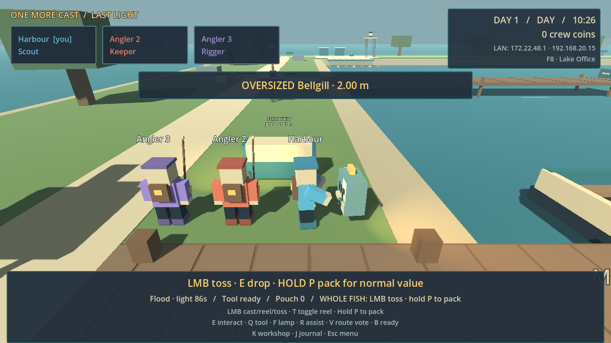

# First playable — evidence and family acceptance

10 October 2026 · build 0.1.0-slice · protocol 1 · save schema 1.

This is the first integrated slice of One More Cast, not the completed island campaign. It is an original Godot desktop game. Roblox/Minecraft/Human Fall Flat are inspirations, not dependencies.

## Delivered behavior

- Native Host/Join for three Windows players; one host household with three saved profiles.
- Authoritative movement, casts, two fish behaviors, three species, Oversized catches and transparent rare protection.
- Grab, drop, short toss, receive, pack, bounded whole-fish physics and water recovery. One fish ID cannot pay twice.
- Saved coins, catch discoveries/records, found Soft-tip Rod, crafted Surveyor Lantern, personal loadouts, shared unlocked gear and one permanent walkway repair.
- Scout reveal, Keeper shelter, Rigger rescue/assist; universal fishing and revival.
- One nightly crew ballot changes which station remains powered. The valuable Reeds casting area sits beyond its safety radius.
- Warned night hunter, light protection/slowdown, rescue, refuge readiness, storm cutoff, settlement and dawn.
- Host Lake Office, readable block art, actual fishing line/bobber, cosmetic Odd Catch, boat crossing presentation and local sound mute.

## Verification performed

| Evidence | Scope and limit |
|---|---|
| GUT suite in `logs/full-suite-final.log` | 88/88 tests, 515 assertions across 14 scripts; unit rules, durable file saves, actual composed controller, HUD and real Jolt bodies |
| `tests/controller_flow_probe.gd` / `logs/controller-flow.log` | 13 checks: real reel intents land catches, earn 30 coins, find/craft/equip gear, repair, choose Reeds, depart, settle, start dawn and independently reload disk. Accelerated ticks/authored travel fixtures; not a timing or fun measurement |
| `tests/integration/run_network_probe.ps1` | 139 checks, three independent ENet processes, all-player movement, state/pose agreement, one shared fish, remote grab, carrier disconnect, stable profile with a new peer ID, independent save reload, simultaneous client departure/reconnect and actual host exit. All exit 0 without warnings/errors or forced stops. Receipt: `.tools/network-probe/20261009T163244592_d71f446c/summary.json` |
| `tests/art_world_probe.gd` | Ground support, marker placement and route/shortcut connectivity |
| `tests/gameplay_effects_probe.gd` | Snapshot-driven line/ability/cosmetic/refuge presentation; authoritative poses unchanged |
| `tests/gameplay_visual_probe.gd` | Actual main scene, controller, HUD and GPU-rendered day/walking/cast/haul/night/refuge images. Movement driven through real intents. Seeded travel/catch fixtures; not screenshots of natural family play |
| `tools/build_windows.ps1 -RenderSmoke` | Official pinned tool checks, embedded-resource inspection, copied clean-folder release headless/OpenGL startup, ZIP and SHA-256 receipts |

Development GPU observed: NVIDIA GeForce RTX 4070 Laptop GPU, Compatibility/OpenGL 3.3. That is not evidence for the other laptops. Tests use isolated saves; no household progress was fabricated for the playable build.

The gameplay probes ran under the pinned development engine. The release executable separately passed clean-folder headless and OpenGL menu startup. Attempting to inject the external gameplay scripts into the release did not execute those probes; the owned processes were stopped, and that attempt is not counted as gameplay verification.

## Final package

- `C:\game-3\build\OneMoreCast-windows.zip` — 39,390,279 bytes; copy this to each PC and extract it.
- `C:\game-3\build\windows\OneMoreCast.exe` — 109,296,792 bytes; embedded runtime data, no editor required.
- Release evidence: `build/evidence-20261009T163441852/`; import, release export, 61-resource embedded-pack inspection and both clean-folder startup checks passed.
- Executable SHA-256: `f62d19e43fbfd46b35a0335ff31071014c175d763d7800c2cf3a952dc9c00e94`.
- ZIP SHA-256: `f29957b7acea9789c688154d3fa9d9a01e2e6ff938e6ec5c0bab7cebab64aea0`.

This image is from the working main scene, not concept art. Its catch and starting positions were seeded by the rendering probe.

Independent review found and corrected failed-save/disconnect recovery, paused fish ownership release, next-day hunter slowdown leakage and pause during the dawn recap. A follow-up regression also covers reconnecting before a failed pouch catch retries. Integration inspection additionally corrected counter-steer cancelling casts, lamp toggles overwritten by snapshots, invisible ballot/host panels, repeated ballot reset, safe-return fallback positions and fishing from protected Reeds shelter.

A final network rerun exposed simultaneous-disconnect teardown errors after the gameplay checks passed. A deterministic two-disconnect stage reproduced them. Disabling unused client relay and deferring remote roster publication until transport polling finishes fixed the source race. The launcher now drains owned process pipes through EOF before reading logs. The stronger 139-check run above passed naturally.

## Not yet proven

- Three physical PCs joining through the real home network, Windows firewall behavior and weakest-PC performance.
- Whether catching and carrying feel good, the camera stays comfortable during free play, and a missed pass is funny rather than annoying.
- Whether both battery choices feel worthwhile, the roles matter without obligations, and the family voluntarily wants another night.
- Full campaign: twelve-species collection, additional gear, second route, beacon/Moth repairs, final channel escape and continuation after the ending.
- Gamepad support, rebinding, comprehensive graphics/audio settings and accessibility tuning. The current build uses keyboard/mouse and a mute control.

## Family session — about 25 minutes

Record the exact ZIP/build, host PC and both client PCs. Do not delete the host save to troubleshoot joining.

1. **Five-minute dock experiment:** move, pass, miss, recover from water, pack, pause mid-flight, disconnect a carrier, reconnect the same profile. Look for awkward aiming, blocked camera or duplicated fish.
2. **One ordinary night:** catch and bank, find gear, make the battery decision, try a rescue if danger naturally provides it, then ready for refuge. Nobody is assigned permanent light duty.
3. **Second short trip:** try the other battery destination and alternate rod/lamp. Reload the host and confirm purchases, records and the repaired walkway persist.
4. Each person independently answers: favourite moment; biggest frustration; did a teammate/equipment choice change what happened; would you choose another trip?

| Player/device | Joined | Controls/camera | Fish pass/recovery | Save/rejoin | Day/night performance | Favourite / frustration / another trip |
|---|---|---|---|---|---|---|
| Host / parent | Pending | Pending | Pending | Pending | Pending | Pending |
| Crew 2 | Pending | Pending | Pending | Pending | Pending | Pending |
| Crew 3 | Pending | Pending | Pending | Pending | Pending | Pending |

Acceptance stays pending until real observations exist. The next change should address the largest observed frustration. If carrying remains awkward after one focused adjustment, simplify it before adding content. Preserve the campaign destination without making the first playtest an obligation to approve the design.
