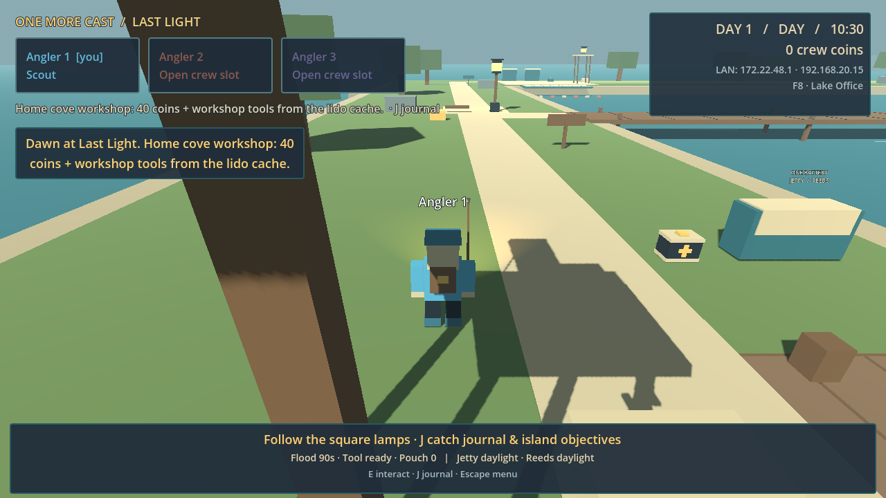
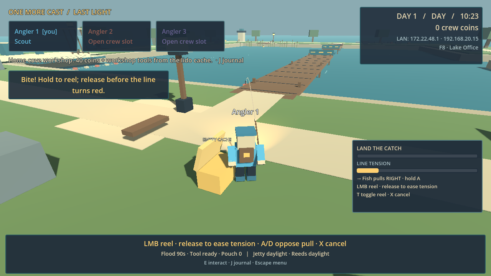
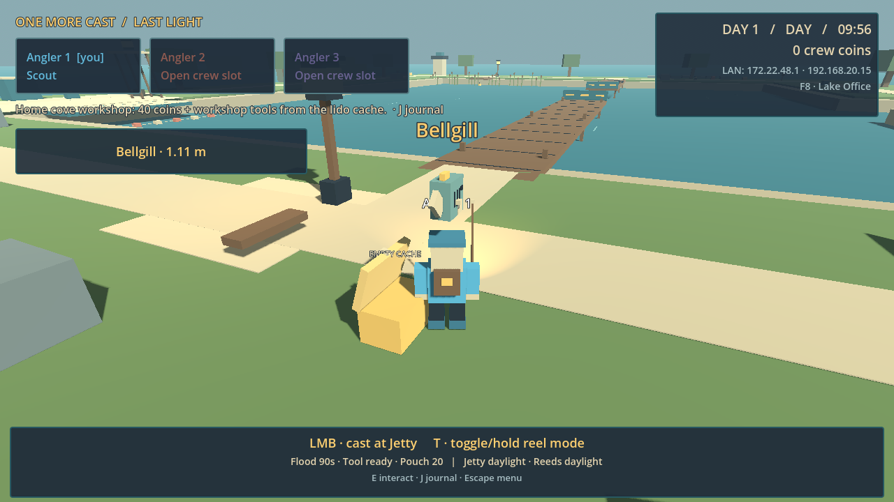

# Pre-overhaul scripted review — 10 October 2026

This records the game **before the toy-diorama art overhaul and compact crew-pill HUD**. It is a retained baseline, not a verdict on later changes.

## Evidence and limits

I reviewed the existing world/gameplay as a separate implementation owner, but I authored the earlier HUD/audio changes. This is **not an independent assessment of my own UI, a blind outsider test, a human playtest, or a three-person family session**. Scores below are provisional judgments from rendered frames and a short scripted solo run.

The probe ran the normal game through Godot 4.7.2's OpenGL renderer at 1280×720. It used ordinary mouse/key input to open Help, click Host, walk a preselected route, open a cache, cast, reel, countersteer and pause. It read game state to choose countersteering and release timing. It did not teleport the player, accelerate time, or change gameplay state directly. Saves/settings were isolated. The retained run landed a Bellgill after 26.447 seconds of fishing; it went into the pouch. A whole-fish throw, banking, a full night, multiplayer rescues and a completed campaign were **not exercised**. Generated audio was tested in code, **not listened to**.

Evidence: [retained run log](ordinary-input-review.log), [probe source](../../tests/integration/ordinary_play_review.gd). Screens below are original captures from that run, copied without visual edits.

## Provisional scores

| Area | Score | Evidence or inference |
|---|---:|---|
| Graphics | 2/10 | Observed: cuboid trees, boulders, caches and crew; broad flat beige paths; largely empty teal water. These read as a blockout. |
| Menus | 7/10 | Observed: concise Host/Join choices and accessible Help. Self-review of UI I authored. |
| Navigation | 5/10 | Observed: a named workshop/lido objective, tiny distant labels and few distinctive landmarks. Inference: a new player could struggle to find the named destination. The scripted route does not establish discoverability. |
| Fishing pacing | 6/10 | Observed: responsive cast/reel input and a 26-second catch. Inference: much of the player's attention goes to meters; the catch needs stronger physical and visual presence. |
| Cooperation potential | 6/10 | Design inference only: carrying and rescues could produce shared decisions. Three-player cooperation was not assessed in this run. |
| Fun potential | 5/10 | Inference: the core loop functions, but these short scenes show little physical comedy or visual surprise. This is not a measured fun score. |

## Highest-value observations

1. **Art identity comes first.** Changing the scenery and character silhouettes is likely to matter more than adding particles to the same boxes. The spawn frame is partly blocked by a large tree trunk. Water, shoreline and distant landmarks need clearer shape and depth.
2. **Fishing should frame the water.** The first cast was allowed from grass beside an open cache. The character, cache and path dominate the image more than the fishing spot. This weakens the sense of fishing at a physical place.
3. **Navigation needs visible destinations.** Give the workshop, jetty and beacon distinct silhouettes and readable near-field signs. A textual destination without a recognizable landmark shifts the work into the UI.
4. **Do not add more systems to solve presentation.** The existing catch, delivery, power-cell and rescue actions need clearer animation, feedback and spatial staging before more mechanics.

## Viable art directions

1. **Warm toy diorama — recommended.** Rounded crew limbs/heads, chunky irregular rocks and tree crowns, curved sand edges and depth bands, cream/teal/rust colors, soft-looking contact shadows. Best fit for family cooperation and gentle physical comedy.
2. **Painted storybook coast.** Faceted irregular terrain, bent trees and reeds, a restrained warm palette, horizon haze and stronger landmark silhouettes. Reuses more of the existing geometry.
3. **Moody coastal miniature.** Indigo water and sky, warm lamps, sea mist and strong silhouettes. Useful for night mood; readability must remain high for a family audience.

Cherry-pick the first direction's silhouettes, the second's shoreline variation and the third's night contrast. Judge one home-cove-to-jetty slice in matching gameplay frames before extending it across the island.

## Original frames

Other retained frames: [menu](screens/pre-overhaul-01-menu.png), [Help](screens/pre-overhaul-02-help.png), [jetty approach](screens/pre-overhaul-04b-jetty-edge.png), [pause](screens/pre-overhaul-09-pause.png).

## Fresh UI pass — functional review, before the next world/movement revision

The old compact HUD still put too much text over the world and the workshop/journal were long catalogs. This pass changes the structure: a left-aligned Home menu, separate Host and Join forms, Settings/Help links, a small contextual keycap, icon/count status, compact crew status, and time in the opposite corner. The permanent objective paragraph and full-width footer are gone. Workshop uses three small existing-purpose tabs; the journal shows one selected fish. No game systems were added. Catalog contents refresh when the saved revision changes instead of every render update.

Actual native renders at **1280×720 and 960×540** verified the new Home/Host/Join flows and a hosted spawn. Urgent-state renders use an **authored snapshot over a daytime world** to check rescue, ballot, power, fishing and context at once; they do not prove night play or simultaneous gameplay validity. The first render exposed invisible Settings/Help links caused by zero-width clipped buttons. A failing regression test reproduced that defect before it was fixed. The final render has no action/fishing/toast/ballot overlap; Workshop Gear and Pause fit without scrolling. The bounded HUD suites pass **44 tests / 236 assertions**. These are functional/layout results, not proof of fun, approval of the art direction, or independent review of my own UI.

Before/after images are untouched native captures. The earlier UI fixtures have a plain background; the after captures use the actual current world. They are **not a matched world-art benchmark**. Both resolutions are preserved as `screens/ui-before-{1280,960}-{menu,gameplay}.png` and `screens/ui-after-{1280,960}-{home,host,join,spawn,workshop,journal,edge-states}.png`.

Evidence: [focused tests](hud-redesign-focused.log), [native render log](fresh-hud-render.log), [1280 Home](screens/ui-after-1280-home.png), [960 Join](screens/ui-after-960-join.png), [1280 hosted spawn](screens/ui-after-1280-spawn.png), [960 workshop](screens/ui-after-960-workshop.png), [960 journal](screens/ui-after-960-journal.png), [960 authored urgent states](screens/ui-after-960-edge-states.png).

The rounded-crew/Kenney-coast intermediate art was a visible improvement over the original blockout, provisionally **5/10 graphics** versus the baseline 2/10. It still looked like a sparse test map. That judgment is about this retained intermediate state; another world/character/movement revision is in progress. The two concrete priorities from the ordinary-input frames were:

1. **Put the water and catch at the center of fishing.** The old ordinary route allowed casting while grass/cache/path dominated the view and the bobber was tiny. The camera faced the correct focus; the cast began inland. This was spatial staging, not an incorrect yaw. The large local self-name has since been removed.
2. **Replace slab-like terrain with a believable playable shore.** Rounded props alone did not disguise the broad flat rectangular land pads and straight routes. The current source has started shoreline changes; this document does not score an unfinished replacement world from stale screenshots.

The short earlier ordinary-input current-art run landed a Penny Perch after **15.505 seconds** using state-informed reel/countersteer decisions and packed it for 10 coins. It did not test three-person cooperation, a full night, whole-fish banking, the new menu flow through ordinary input, or the latest replacement world. A replay is deferred until the moving world/input work settles, rather than claiming an old route validates it.

## Movement check — rigged crew and curved shore

The revised controller starts and stops with bounded acceleration, turns while moving, retains facing while the camera orbits at rest, and offers mouse-wheel zoom. A render-only transform interpolates the character and camera target between physics ticks; collision bodies, cargo clearance and authority remain on the physics state. Accepted casts now face their water focus. Throws use validated view yaw and reject a turn if the held object's swept clearance would cross a wall. A small shared translucent foot shadow anchors the character without dynamic shadows.

Reference: [GDQuest's 3D character movement tutorial](https://www.gdquest.com/library/character_movement_3d_platformer/), its MIT-licensed code at tag 1.1.0, and [Godot's interpolation guidance](https://docs.godotengine.org/en/stable/tutorials/physics/interpolation/advanced_physics_interpolation.html). No GDQuest art was imported. The movement license is preserved in the repository.

The native probe used normal GUI Host clicks, held W for 1.8 seconds, released it, orbited with a right drag and scrolled once. It used isolated saves and no teleports or forced movement state. Both 30 and 120 FPS caps travelled **8.913 m**, retained idle facing exactly and zoomed from 7.5 to 6.9 m. At the 120 cap, 165 sampled rendered frames included **83 unchanged physics positions and zero unchanged visual positions**. The largest visual/body offset was one physics interval, **0.0833 m**. Observed frame p50/p95 were 33.025/35.899 ms at the 30 cap and 8.108/10.445 ms at the 120 cap. These short capped samples verify interpolation behavior; they are not a comprehensive performance benchmark.

Focused action-facing, movement, camera clearance, carry, appearance and outfit checks passed **29 tests / 237 assertions**, with no script errors. The action tests cover accepted and rejected casts, fish and cell throw direction/origin, and preservation of held cargo/pose/velocity when a wall blocks turning. The native movement route did not exercise a cast, throw, multiplayer rescue, full night or completed campaign. This is implementation verification, not a blind outsider or human feel test. Jump was not added.

The captured character now visibly walks and plants its feet, and the camera leaves more clear world space. The shore still looks sparse and fairly flat; passing these checks does not establish that the overall presentation is finished or fun.

Evidence: [focused checks](movement-action-focused.log), [native input log](movement-native.log), [probe source](../../tests/integration/render_movement_native.gd), [30-cap walk](screens/movement-30-walk.png), [120-cap walk](screens/movement-120-walk.png), [120-cap idle orbit/zoom](screens/movement-120-idle-orbit-zoom.png).
